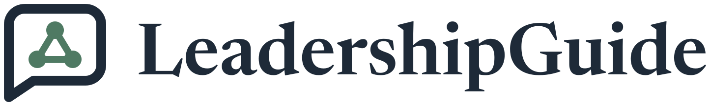

<p align="center">
  <picture>
    <source media="(prefers-color-scheme: dark)" srcset="docs/brand/svg/leadershipguide-logo-on-dark.svg">
    
  </picture>
</p>

<h1 align="center">Leadership coaching in Turkish. Answers from a Weaviate vector store.</h1>

<p align="center">
  A retrieval-augmented leadership chatbot with a Weaviate vector store and a Streamlit interface.<br>
  <b>281 chunks from 27 interviews. GPT-4o. Google fallback. Local Docker or Weaviate Cloud.</b>
</p>

<p align="center">
  <a href="LICENSE"></a>
  
  
  
  
  <a href="https://github.com/mertkayacs/Weaviate-Based-LeadershipGuide-Chatbot"></a>
</p>

<p align="center">
  <a href="#quick-start"></a>
  <a href="docker-compose.yml"></a>
  <a href="https://github.com/mertkayacs/Leadership-Coach-Chatbot"></a>
</p>

LeadershipGuide is a Turkish leadership coaching chatbot built as a retrieval-augmented generation pipeline. It answers from a Weaviate vector store of transcribed leadership interviews, with a Google Search fallback when the stored content does not fit the question. GPT-4o checks relevance and writes the answers, and a Streamlit interface serves the chat. It is the Weaviate variant of the Leadership Coach chatbot.

---

## Why LeadershipGuide

The pipeline keeps the interview chunks in a vector database.

|  |  |
|---|---|
|  **Weaviate store** | The upload script creates a `LeadershipContent` collection and loads 281 chunks from `turkish_chunks.json`. |
|  **Local or cloud** | The Streamlit app uses the local instance from docker-compose.yml. The command line chatbot connects to Weaviate Cloud through `WEAVIATE_URL` and `WEAVIATE_API_KEY`. |
|  **Multilingual embeddings** | HuggingFace sentence-transformers (paraphrase-multilingual-MiniLM-L12-v2) embed the Turkish chunks and the questions. |

## Features

**Retrieval**

- Weaviate collection with the transcript chunks, queried through LangChain.
- GPT-4o relevance check before answering.
- Google search fallback.

**Data pipeline**

- yt-dlp downloads a YouTube playlist and Whisper transcribes it.
- prepare_transcripts.py cleans the subtitles into the chunks file. The processed data ships in the repository.

## Quick start

```sh
docker compose up -d
pip install -r requirements.txt
python upload_to_weaviate.py
streamlit run steamlit_leadership_chatbot.py
```

Set `OPENAI_API_KEY` for GPT-4o, plus `GOOGLE_API_KEY` and `GOOGLE_CSE_ID` for the Google fallback before starting the app.

The compose file enables anonymous access and binds ports 8080 and 50051 to 127.0.0.1, so Weaviate is reachable from the local machine only.

### Requirements

- Docker with Compose.
- Python with the packages in requirements.txt.
- An OpenAI API key and Google search credentials.

## FAQ

<details>
<summary><b>How is this different from Leadership Coach?</b></summary>

That repository keeps the embeddings in memory and needs no database. This one stores them in Weaviate. See [Leadership-Coach-Chatbot](https://github.com/mertkayacs/Leadership-Coach-Chatbot).
</details>

<details>
<summary><b>Do I have to run the transcription pipeline?</b></summary>

No. The processed chunks are in the repository.
</details>

<details>
<summary><b>Can I use Weaviate Cloud?</b></summary>

The command line variant `chatbot.py` can, with WEAVIATE_URL and WEAVIATE_API_KEY. The Streamlit app uses the local Docker instance.
</details>

If LeadershipGuide is useful to you, a ⭐ helps other people find it.

## License

[Apache License 2.0](LICENSE). See the LICENSE file for the full text.

[](https://github.com/mertkayacs/Weaviate-Based-LeadershipGuide-Chatbot)
